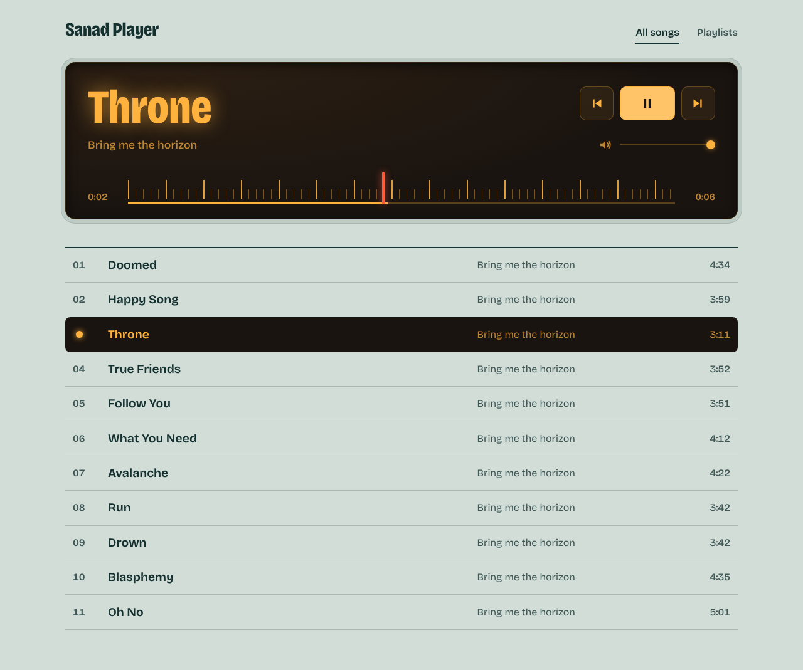
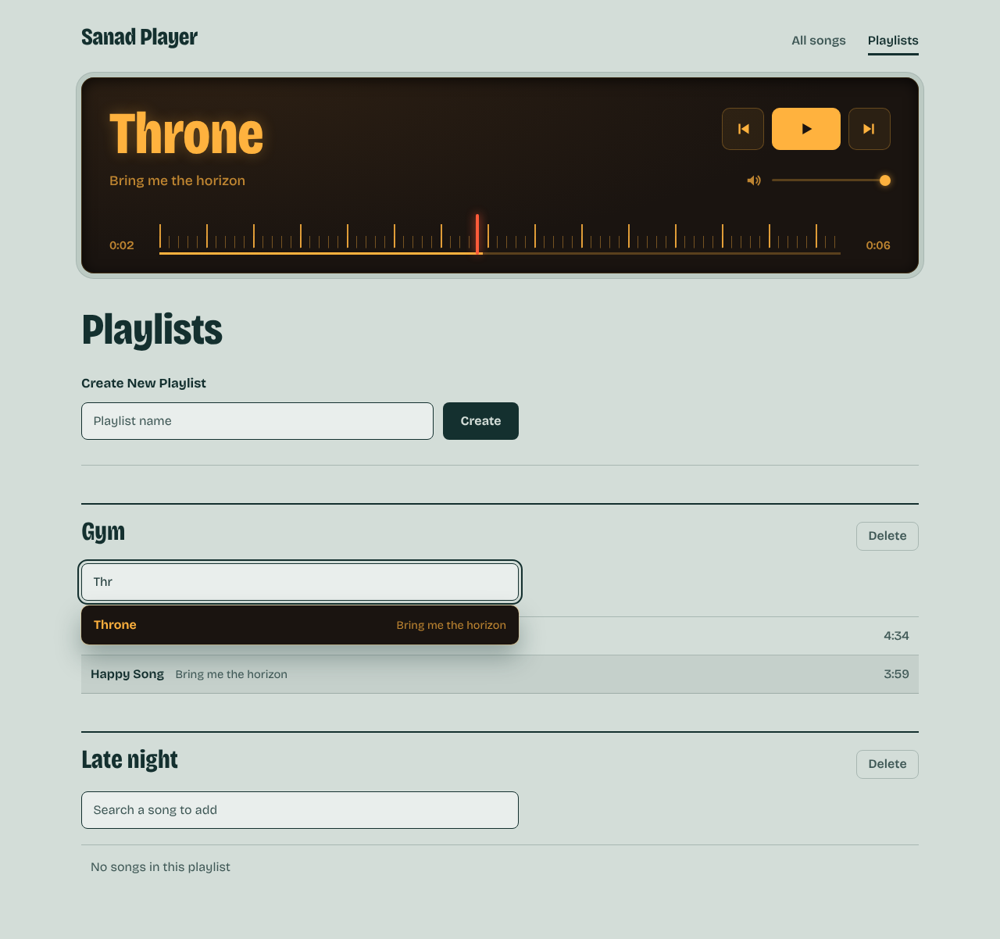
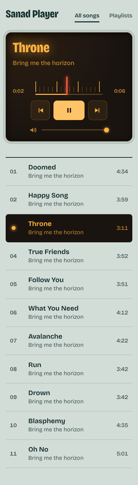

# Sanad Player

A browser music player with playlists, built with React. It remembers the last track and position, and lets you group songs into playlists that survive a reload.

**[Live demo](LIVE_DEMO_URL)** · Project type: logic-led (app logic written by hand, visual design AI-assisted)



## Features

- Play, pause, previous and next, with auto-advance when a track ends
- Seek on a tuning-dial scale and adjust volume
- Resumes the last track and position after a refresh
- Create and delete playlists, and add songs through a search dropdown
- Playlists are saved in `localStorage`
- Keyboard accessible: native buttons, labelled controls, visible focus
- Responsive from 320px up

| Playlists | Mobile |
| --- | --- |
|  |  |

## Tech stack

- React 19 and React Router 7
- Vite 8
- State: Context API with a custom `useMusic` hook
- Styling: plain CSS (custom properties, grid, CSS-mask icons), Bricolage Grotesque via Fontsource
- ESLint with the `react-hooks` rules

## How it was built

This started as a follow-along tutorial project. After finishing it, I reviewed it for bugs, fixed and extended the logic, and restyled it completely so it no longer resembles the original.

- **Application logic** (audio handling, state, persistence, playlists): written and fixed by me.
- **Visual redesign** (layout, palette, typography, CSS): produced with AI assistance (Claude).
- **Review:** an AI code review helped me find bugs, which I then fixed myself.

### Bugs found and fixed

- Adding a song crashed the app when there was more than one playlist (a `map` callback returned `undefined` for the other playlists).
- After a refresh the saved position and the active track were not restored correctly.
- Saved data was loaded inside an effect after the first render; it is now read once through lazy `useState` initialisers.
- Empty and duplicate playlist names were accepted.

## Run locally

Requires Node.js 20.19 or newer.

```bash
npm install
npm run dev
```

Other scripts: `npm run build`, `npm run preview`, `npm run lint`.

### Audio files

The audio files are not part of this repository. Put your own royalty-free `.mp3` files in `public/songs/` and list them in the `songs` array in `src/contexts/MusicProvider.jsx`:

```js
{
  id: 1,
  title: 'Song title',
  artist: 'Artist',
  url: '/songs/file-name.mp3',
  duration: '3:21',
}
```

## Project structure

```
src/
  components/   AllSongs, MusicPlayer, Playlists, Navbar
  contexts/     MusicContext, MusicProvider (state and actions)
  hooks/        useMusic
  styles/       index.css
```

## Roadmap

- Generate the track list from the audio files' metadata with a build-time script
- Remove songs from a playlist, and play a playlist as a queue
- Shuffle and repeat
- Component tests

## Credits

- Font: [Bricolage Grotesque](https://fonts.google.com/specimen/Bricolage+Grotesque) (SIL Open Font License)
- Tracks: add the artist and license for each track you ship here

## License

[MIT](LICENSE)
